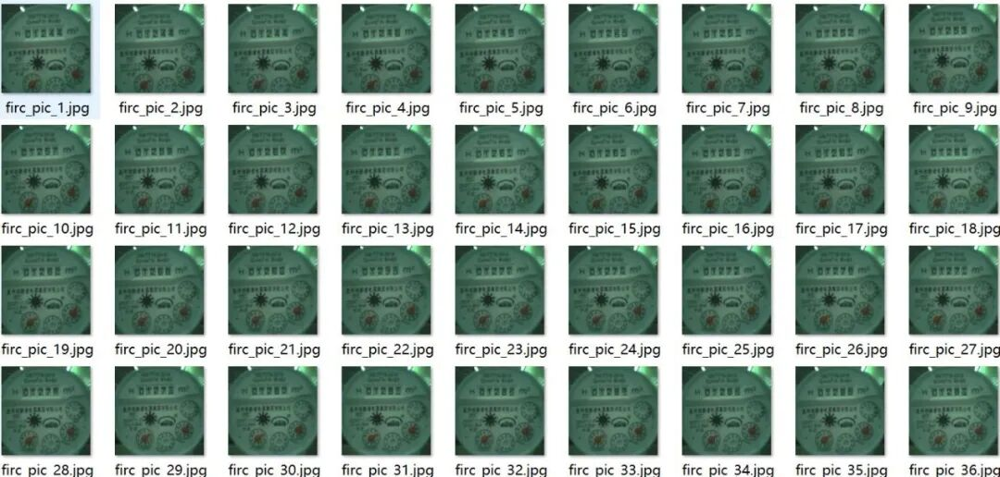
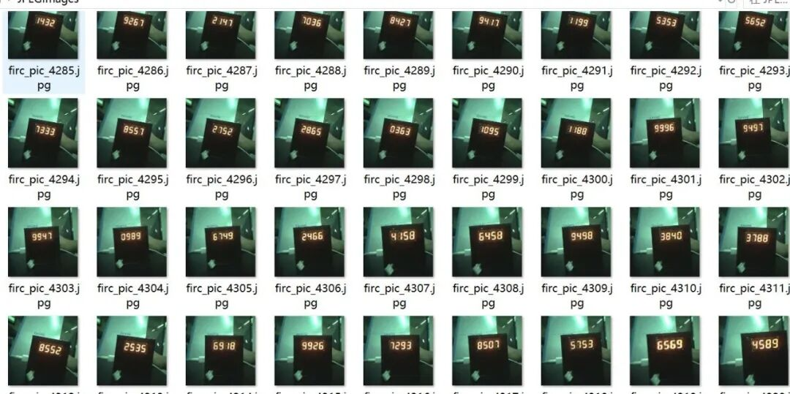
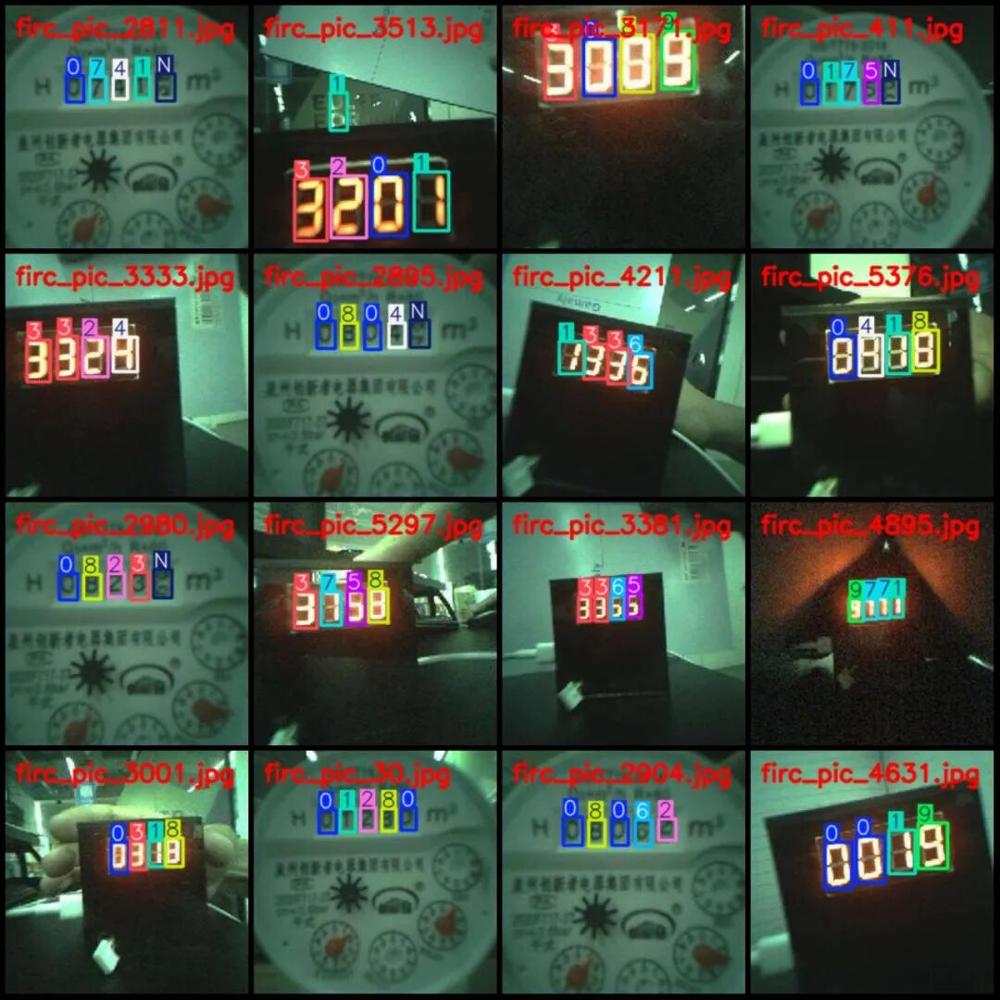
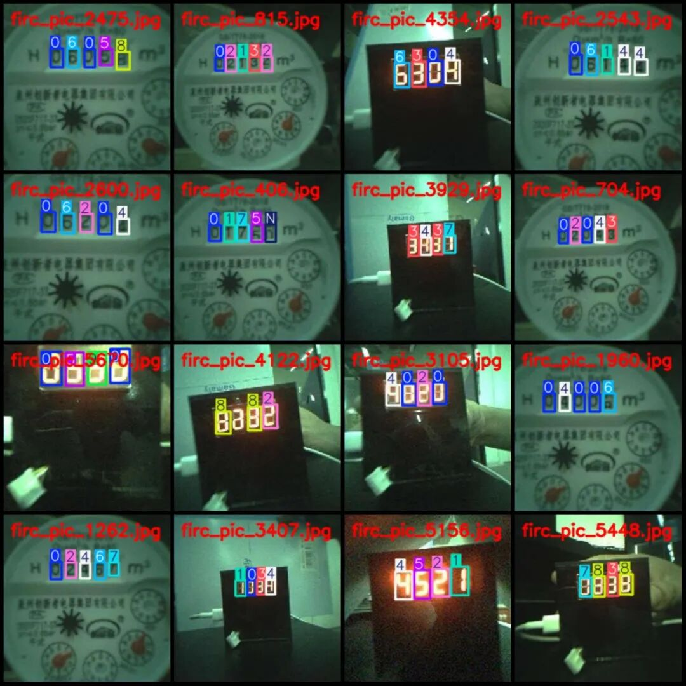
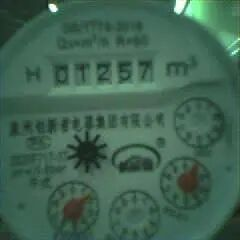
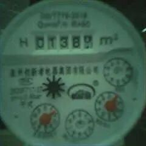
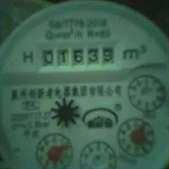

# Industrial Instrument Digital Recognition Detection Dataset VOC+YOLO format, 5802 images in 11 categories at low resolution

Please note that the dataset images have a resolution of 240x240, which is somewhat blurry. Please refer to the provided images for specific details.

Dataset format: Pascal VOC format + YOLO format (txt file without split path, only containing jpg images and corresponding VOC format xml files and yolo format txt files)

Number of images (number of jpg files): 5802

Number of annotations (number of xml files): 5802

Number of annotations (number of txt files): 5802

Labeling category count: 11

Label category names (Note that the order of yolo format categories does not correspond to this, but is based on the labels folder's classes.txt): ["0", "1", "2", "3", "4", "5", "6", "7", "8", "9", "N"]

Number of boxes and the number of images occupied by each category:

0 Frames = 5170, Pictures Taken = 3961

1. Frame count = 2828, occupying image count = 2330

2. Frame count = 3304, Image count = 2615

3. Frames = 2048, Pictures occupied = 1784

4. Number of frames = 2050, number of images occupied = 1788

5. Number of frames = 1876, number of images occupied = 1637

6. Number of frames = 1946, number of images occupied = 1716

7 Frames = 1945, Pictures Taken = 1723

8 Frames = 2244, Pictures Taken = 1898

9 Frames = 2072, Pictures Taken = 1811

N Frames = 841, occupying images = 774

Image resolution: 240x240

Using labelImg:

Annotation rules: Draw a rectangle around the category.

Important Notice: The dataset does not have separate training, validation, and test sets; you need to partition them yourself.

Special : This dataset does not guarantee the accuracy of the trained models or weight files.

Image Preview:

Annotation example:

Single image:

## Payment

Here is a pay link on Stripe ( https://buy.stripe.com/3cs8yP7sY87d0vu9AB ). Please contact me lonlonago@foxmail.com after funding $89, and I will send you a complete data files , thank you!

